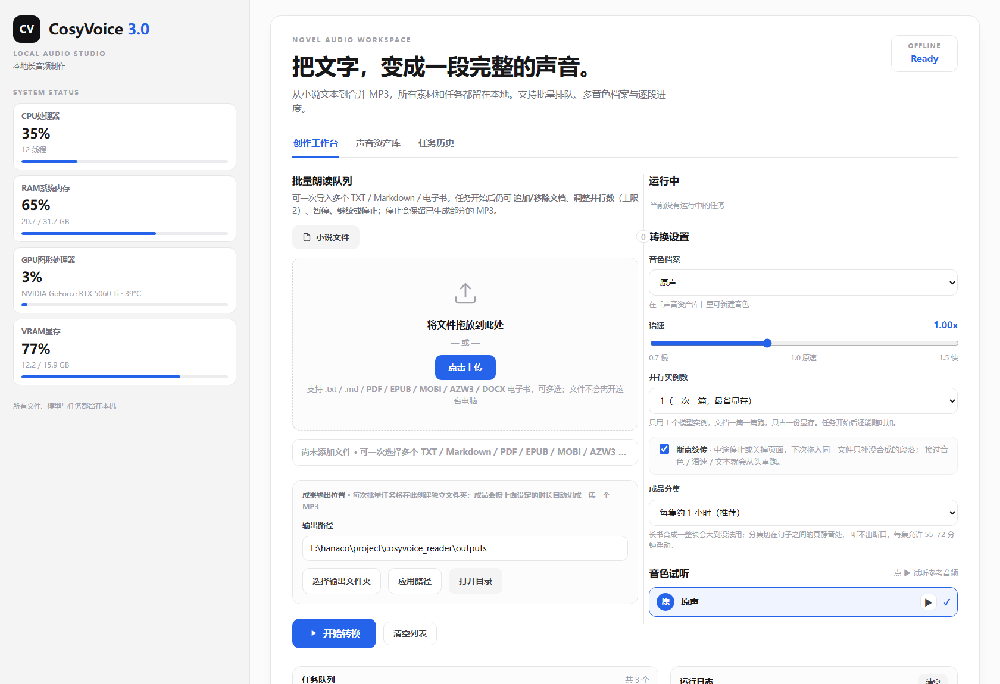

# CosyVoice Reader

> 把一本小说丢进去，第二天收获一整套有声书。

一套跑在自己电脑上的长篇有声书生产线：**电子书导入 → 多角色配音 → 断点续传 → 多实例并发 → 按小时自动分集**，全程离线，素材和音频都不离开本机。

基于 [CosyVoice 3.0](https://github.com/FunAudioLLM/CosyVoice)（零样本音色克隆）构建，但不是它的 WebUI 换皮 —— 它解决的是"一本 24 小时的书，怎么在 12 小时里稳定跑完、中途断电还能接着跑"这类工程问题。



<sub>中文界面 · 左侧实时硬件状态 · 双栏工作区（中间竖条可拖动调整左右比例）</sub>

---

## 它能做什么

| 能力 | 说明 |
|---|---|
| **电子书直接导入** | `.pdf` `.epub` `.mobi` `.azw3` `.azw` `.prc` `.docx` `.txt` `.md`，拖进去自动抽成正文 |
| **多角色配音** | 正文里写 `[张三] 说的话`，就能把不同角色分给不同音色；也可一键用规则引擎自动识别"张三说：…"这类对话 |
| **断点续传** | 中途停止、关页面、甚至断电，下次拖入同一个文件只补没合成的段落 |
| **多实例并发** | 最多 2 个模型实例同时跑；只剩一本书时，两个实例一起给这本书**按段并发** |
| **暂停 / 继续 / 停止** | 在段落边界生效，不会切断半句话；停止时保留已生成部分的 MP3 |
| **按小时自动分集** | 成品按"约 1 小时一集"切开，切口落在句子之间的静音处，听不出断口 |
| **任务中动态调整** | 跑着的任务可以随时追加/移除文档、改并发数 |
| **音色试听** | 点 ▶ 直接播放该音色的参考音频，不用等合成 |
| **纯本地** | 不联网、不上传、不依赖任何云服务 |

---

## 为什么它不是"又一个 TTS demo"

长篇小说会把所有粗糙的地方放大：24 小时音频 = 457 个合成段 = 12 小时机时，中间任何一次崩溃都意味着从头再来。所以真正的功夫在调度层：

**1. 段是原子的，断点记在磁盘上**
每合成完一段就写一个 `.done` 标记 + 一段 WAV，同时更新 `resume.json`（含文本段落列表的 sha256 指纹、音色、语速、角色映射）。判断"能不能续传"靠指纹比对：换了文本、音色、语速、角色映射中的任何一项，旧分段作废、从头重跑 —— 避免把两种声音拼进同一个 MP3。

**2. 并发单位不是"线程"，是"实例"**
每加载一个模型实例约占 5.7 GB 显存，16 GB 卡的上限是 2 个，所以并发不能靠加线程。原来的实现是"一篇文档占一个实例"，于是两本书跑完后剩一本时，另一个实例就空转 20 小时。改成**篇内按段并发**后，单本吞吐从 15–16 段/时提到 29–34 段/时。

**3. 长音频必须能中途落盘**
每累计约 10 分钟就合并出一个 `parts/*.pNN.mp3` 分片。这样即使跑到第 8 小时崩溃，前 7 小时的音频已经是可直接播放的成品。**分片边界不存盘，而是从磁盘上的分段 WAV 重新累加算出来的** —— 进程被 `kill -9` 也不会切错位置。

**4. 上游 wetext 有两个静默坑**
一是某些符号紧贴数字（`[eBook #1342]`、`1#`、`a[1`）会让 `normalize()` 抛 `AssertionError`；二是某些 URL 片段会让它**静默返回空串**，随后 `split_paragraph('')` 抛 `IndexError`。1708 个段落里有 1 段踩中，整本书就废。处理方式是两层：入库时先做文本清洗（`document.tts_safe`），运行时再给前端加保险（`install_frontend_guards`，捕获异常和空串并退回原文）。详见 [`docs/疑难问题修复记录.md`](docs/疑难问题修复记录.md)。

**5. 中文排版会污染指纹**
`resume.json` 用段落列表做指纹，而 `#`、`*`、`-` 这类 Markdown 残留会随清洗规则变化。所以清洗是**单一入口**（`document.load_text`）：计数、指纹、合成都走同一条路，否则进度百分比会和实际段数对不上。

---

## 实测数据

一台 RTX 5060 Ti 16 GB / 12 核 / 32 GB 的普通台式机：

| 项目 | 数值 |
|---|---|
| 书 | 《弑君者传奇：风之名》 457 段 |
| 成品时长 | 24 小时 33 分 |
| 总机时 | 约 12 小时 6 分（≈ **2.0× 实时**） |
| 双实例显存占用 | 11.5 GB / 16 GB |
| 单实例 RTF | 0.87（`TensorRT` 实测 0.870 vs fp32 ONNX 基线 0.871，**没有收益，已放弃**） |
| 分集结果 | 25 集，单集 55–73 分钟、67.4 MB |
| 另一本 | 《山音》 122 段 → 6 小时 49 分 → 7 集 |

> 想再快只有两条路：把单实例显存压到 4 GB 以下（量化，可能损音质），或换更大显存的卡。加线程没用 —— 瓶颈是显存装不下第三个实例。

---

## 安装

### 前置条件

- **Windows 10/11**（本项目只在 Windows 上验证过：`start.bat`、`os.startfile`、路径处理都是 Windows 语义）
- **NVIDIA 显卡**，显存 ≥ 8 GB（16 GB 可跑 2 实例，8 GB 建议 1 实例）
- **Python 3.11**
- **git**（拉取上游源码用）

### 三步

```bat
git clone https://github.com/iorlchotae/cosyvoice-reader.git
cd cosyvoice-reader
powershell -ExecutionPolicy Bypass -File scripts\setup_windows.ps1
```

`setup_windows.ps1` 会依次完成：建 `.venv` → 装 CUDA 版 PyTorch → 装依赖 → 拉取上游 CosyVoice（固定在已验证的 commit）→ 打 Windows 补丁 → （可选）下载模型。脚本可重复执行，已完成的步骤会跳过。

装完后双击 `scripts\start.bat`，浏览器会自动打开 <http://127.0.0.1:7860>。想建桌面快捷方式：

```powershell
powershell -ExecutionPolicy Bypass -File scripts\make_shortcut.ps1
```

---

## 模型（不进仓库，按需下载）

模型权重 `Fun-CosyVoice3-0.5B-2512` 约 **10.3 GB**，不随仓库分发。三种拿法，任选其一：

**① 从 ModelScope 下（国内快）**

```bat
.venv\Scripts\python.exe scripts\download_model.py --source modelscope
```

**② 从 HuggingFace 下**

```bat
.venv\Scripts\python.exe scripts\download_model.py --source huggingface
```

**③ 已经有模型，只改指向**

```bat
set COSYVOICE_MODEL_DIR=D:\models\Fun-CosyVoice3-0.5B-2512
```

默认位置是 `<项目上级目录>\models\Fun-CosyVoice3-0.5B-2512`。启动时如果找不到模型，界面会直接告诉你缺哪个目录、该跑哪条命令，而不是抛一屏 `FileNotFoundError`。

> 上游 CosyVoice 源码本身也不入库（它是一个独立仓库 + 子模块），由 `setup_windows.ps1` 克隆并固定在 `074ca6d`，同时应用 `scripts/apply_patches.py` 里的两个 Windows 补丁：绕开 TorchAudio 2.9+ 强制走 TorchCodec 的问题、预加载 CUDA DLL 让 onnxruntime 能找到库。

---

## 使用

1. 把 `.txt` / `.md` / 电子书拖进左侧上传区（可多选，一次一本或多本都行）
2. 右侧「转换设置」选音色、语速、并行实例数、成品分集粒度
3. 点「开始转换」
4. 任务卡片上可以：**暂停 / 继续 / 停止**、**± 调并发**、**追加文档**、**移除文档**、看**百分比进度**
5. 成品在输出路径下：`outputs\<书名>\<书名> 第01集.mp3`、`第02集.mp3`…，外加一个 `resume.json`（续传凭据）

### 多角色配音

正文里给台词加角色标记，一行一句：

```
[张三] 你到底想说什么？
[李四] 我说得还不够清楚吗。
他转身走了，风把门带上。
```

没有标记的行归给「旁白」。已经有"张三说：…"这种写法的普通小说，可以在待跑文档上点「识别角色」，用规则引擎自动转成带标记的副本（不会改动你的原文件）。

### 音色

「声音资产库」里可以上传 5–30 秒参考音频 + 对应文字稿，新建音色档案（零样本克隆，不需要训练）。超长录音会按停顿自动裁到 29.4 秒以内，并用本地 Whisper 把文字稿对齐到裁完的那一段。

---

## 项目结构

```
cosyvoice_reader/
├── app.py                 HTTP 服务 + 任务队列 / 调度器 / 所有 API（无框架，标准库 http.server）
├── index.html             单文件前端（无构建、无 npm）
├── config.py              路径、阈值、并发上限、分集参数
├── document.py            文本分块、角色解析、tts_safe 文本清洗
├── ebook_import.py        PDF/EPUB/MOBI/AZW3/DOCX → 纯文本
├── episode.py             ffmpeg 静音检测 → 按集切分
├── audio.py               wav 时长/裁剪/拼接、合并 MP3
├── voice_profiles.py      音色档案 CRUD、参考音频裁剪与对齐
├── runtime_monitor.py     CPU/内存/GPU/显存 采样
├── task_store.py          任务历史（tasks/*.json）
├── backends/
│   ├── pool.py            模型实例池：就地扩缩、令牌制借还
│   ├── synthesize.py      单篇合成：分段、续传、分片、篇内并发
│   └── cosyvoice3.py      CosyVoice 封装 + 上游文本前端的保险补丁
├── scripts/               启动/停止/安装/模型下载/分集 CLI + 8 套确定性测试
├── docs/                  设计文档（每轮改动的设计与验收清单）
└── voice_profiles/presets/ 预置参考音频（演示用）
```

设计取舍记录在 `docs/design/`，踩过的坑记录在 `docs/疑难问题修复记录.md`。

---

## 测试

不需要显卡、不加载模型，几秒钟跑完：

```bat
set PYTHONIOENCODING=utf-8
.venv\Scripts\python.exe -u scripts\test_queue_logic.py
```

| 测试 | 覆盖 |
|---|---|
| `test_queue_logic.py` | 调度器：预扫描分母、暂停/继续、停止保留半成品、并发扩缩、任务中加减文档 |
| `test_unit_parallel.py` | 篇内并发：峰值并发、段序、并发下停止/续传、分片切点 |
| `test_resume.py` | 断点续传：指纹失效、跳过已完成段、分片边界重算 |
| `test_episode_split.py` | 分集：静音切点选择、时长窗口、集数计算 |
| `test_ebook_import.py` | 电子书：页眉页脚清洗、EPUB spine 顺序、DOCX 段落/表格顺序、加密与扫描件识别 |
| `test_frontend_guard.py` | 上游 wetext 的两种崩法（抛异常 / 静默返回空串）都能兜住 |
| `test_safe_names.py` | Windows 非法文件名、保留名、超长截断 |
| `test_voice_profile.py` | 音色档案：超长裁剪、文字稿对齐 |

全部通过时各自打印 `*_OK`。

---

## 已知限制

- **仅 Windows**。`start.bat`、`os.startfile`、`ctypes` 相关代码都是 Windows 语义；移植到 Linux/macOS 需要改启动与路径处理。
- **单卡最多 2 个实例**。每实例约 5.7 GB 显存；16 GB 卡放不下第 3 个（实测剩 4.8 GB）。`HARD_MAX_WORKERS = 2` 是硬编码上限。
- **不支持 `.doc`**（Word 97-2003 二进制格式），请先另存为 `.docx`；也不支持 `.rtf` `.odt` `.wps` `.fb2` `.lit`。
- **扫描版 PDF 不做 OCR**。抽出来的文字少于 50 字会明确提示是扫描件。
- **单机、单 GPU**，没有分布式；进度只在本进程内存里，进程没了任务卡就没了（但磁盘上的断点还在，拖回同一文件即可续传）。
- 输出固定 **24 kHz 单声道 192 kbps MP3**。

---

## 许可

本项目代码以 **Apache License 2.0** 授权，见 [LICENSE](LICENSE)；第三方组件与素材的归属见 [NOTICE](NOTICE)。

上游依赖：

- [CosyVoice](https://github.com/FunAudioLLM/CosyVoice) — FunAudioLLM，Apache-2.0
- 模型 [Fun-CosyVoice3-0.5B-2512](https://modelscope.cn/models/FunAudioLLM/Fun-CosyVoice3-0.5B-2512) — 遵循其各自的模型许可，不随本仓库分发

`voice_profiles/presets/` 下的参考音频来自上游示例素材，仅用于演示零样本克隆；正式使用请换成你自己的录音。

---

## English

A local, offline audiobook production line for long-form Chinese novels, built on CosyVoice 3.0. It imports ebooks (PDF/EPUB/MOBI/AZW3/DOCX), clones voices from a few seconds of reference audio, maps novel characters to different voices, survives crashes with per-segment resume checkpoints, runs two model instances concurrently (falling back to intra-document segment parallelism when only one book is left), and slices the result into ~1-hour episodes at silence boundaries. Windows only. Model weights (~10 GB) are not included — see [模型](#模型不进仓库按需下载). Measured: a 24.5-hour, 457-segment book rendered in ~12 hours on a single RTX 5060 Ti.
